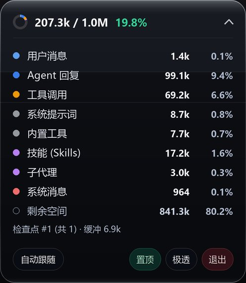

# Antigravity Context HUD

<p align="center">
  <b>Always-on-top Liquid Glass context window monitor for Antigravity Desktop</b>
</p>

<p align="center">
  <a href="README.md">简体中文</a> | English
</p>

<p align="center">
  
  
  
</p>

<p align="center">
  
</p>

A lightweight floating HUD that keeps real-time Antigravity Desktop token usage visible on top of your workspace without opening the side panel.

## Features

- **Standalone & Zero Dependencies**: Built-in Protobuf decoder and model context catalog using Python stdlib only—no external plugins or sidecars required.
- **Liquid Glass Capsule**: Frameless per-pixel alpha pill rendered via Win32 `UpdateLayeredWindow` (`2x` supersampling, specular highlight, no black corners).
- **4 Glass Opacity Levels**: Cycle between `极透` (`42`), `通透` (`96`), `半砂` (`156`), and `深邃` (`216`).
- **Compact & Unified Metrics**: Small segmented ring + single-line `used / 1.0M` percentage view anchored strictly to the model's native context limit (no mixed `256k` budget clutter).
- **Stable & Flicker-Free**: Filters out background subagent DBs without `USER_INPUT`, tracks `.db`/`.db-wal` timestamps only (ignoring `.db-shm` to prevent session jumping), and skips redraws when state is unchanged.
- **High-DPI & Single Instance**: Scales cleanly on 100%–200% displays and focuses the active HUD if launched again.

## Requirements

- Windows 10 / 11
- Python 3.10+ (with `tkinter`)
- Antigravity Desktop (with local conversation data)

## Quick Start

```bash
git clone https://github.com/MH-ai-ai/antigravity-context-hud.git
cd antigravity-context-hud
pip install -r requirements.txt
```

- Double-click **`启动上下文悬浮窗.bat`** to launch silently via `pythonw.exe`, or run:

```bash
python hud.py            # Start collapsed
python hud.py --expanded # Start expanded
```

## Controls

| Action | Behavior |
| :--- | :--- |
| **Drag anywhere** | Move HUD (position auto-saved to `hud_config.json`) |
| **Click arrow / Double-click** | Toggle collapsed pill ↔ expanded breakdown |
| **Bottom buttons** | Switch active/pinned session, toggle always-on-top, cycle opacity, quit |
| **Right-click** | Context menu (expand, refresh, switch session, topmost, opacity, reset position, quit) |

## Project Files

- `hud.py` — Win32 layered Liquid Glass UI & interaction loop
- `core.py` — Read-only SQLite reader & snapshot cache
- `context_parser.py` — Standalone Protobuf context parser & built-in model catalog
- `test_core.py` — Core unit tests (`python -m unittest -v test_core.py`)
- `启动上下文悬浮窗.bat` — Windowless Windows launcher

## License

[MIT](LICENSE)
