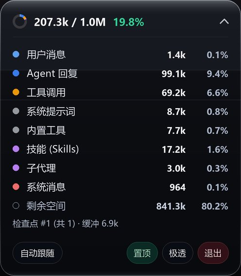

# Antigravity Context HUD

<p align="center">
  <b>始终置顶的 Antigravity Desktop 液态玻璃上下文悬浮监测条</b>
</p>

<p align="center">
  简体中文 | <a href="README.en.md">English</a>
</p>

<p align="center">
  
  
  
</p>

<p align="center">
  
</p>

无需手动切出侧边栏，始终悬浮在桌面最顶层，实时展示 Antigravity Desktop 当前活跃对话的上下文用量与分类占比。

## 特性

- **完全独立零依赖**：内置 Antigravity 2.0 Protobuf 对话数据库只读解析器与模型上下文目录，不依赖任何第三方扩展或外部插件。
- **液态玻璃质感**：基于 Win32 `UpdateLayeredWindow` 2x 超采样逐像素透明绘制，无黑边角，自带弧面高光与菲涅尔亮边。
- **四档通透度切换**：支持 **极透 (`42`) → 通透 (`96`) → 半砂 (`156`) → 深邃 (`216`)** 循环切换，深浅背景均清晰可读。
- **极简小圆环与统一口径**：收起态仅保留小圆环、`已用 / 原生上限` 与百分比，统一按模型原生窗口上限（如 `1.0M`）计算，不混入平台内部 `256k` 裁剪线。
- **防跳变与零闪烁**：过滤无用户输入的子代理会话，仅追踪 `.db`/`.db-wal` 变更（忽略 `.db-shm` 防误跳转），数据不变时不重绘。
- **高分屏与单实例唤醒**：原生支持 High-DPI 缩放，重复运行自动唤醒现有悬浮窗。

## 环境要求

- Windows 10 / 11
- Python 3.10+（包含 `tkinter`）
- Antigravity Desktop（本地任意活跃对话记录）

## 快速开始

```bash
git clone https://github.com/MH-ai-ai/antigravity-context-hud.git
cd antigravity-context-hud
pip install -r requirements.txt
```

- 直接双击 **`启动上下文悬浮窗.bat`**（自动通过 `pythonw.exe` 无黑框运行），或命令行启动：

```bash
python hud.py            # 收起胶囊态启动
python hud.py --expanded # 展开明细态启动
```

## 交互说明

| 操作 | 说明 |
| :--- | :--- |
| **左键拖拽** | 自由移动位置，松开自动保存至本地 `hud_config.json` |
| **点击右侧箭头 / 双击** | 切换收起窄胶囊与展开明细卡片 |
| **底部按钮** | 自动跟随 / 锁定会话、始终置顶、切换玻璃通透度、退出 |
| **右键菜单** | 展开/收起、立即刷新、切换监控对话、置顶、透度、复位右上角、退出 |

## 文件结构

- `hud.py` — Win32 液态玻璃悬浮窗与交互主程序
- `core.py` — 只读 SQLite 对话发现与缓存服务层
- `context_parser.py` — 独立 Protobuf 上下文解析器与内置模型窗口目录
- `test_core.py` — 单元测试（`python -m unittest -v test_core.py`）
- `启动上下文悬浮窗.bat` — Windows 无控制台启动脚本

## 开源协议

[MIT](LICENSE)
